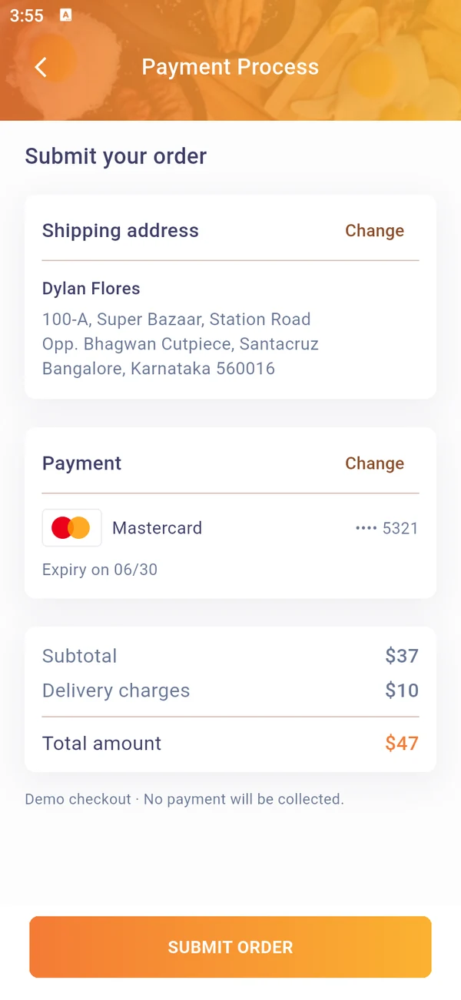

# Tasty Food · Flutter 点餐 App

基于 Pixso「Food app design」的 Android 点餐应用。从三页引导和账户表单出发，可以浏览餐厅与菜品、搜索、管理购物车、更新配送方式并提交演示订单。

## 主要界面

以下截图均来自现有 Android 11 模拟器上运行的 Flutter 应用。

| 首页 | 菜品详情 | 结算确认 |
| :---: | :---: | :---: |
|  |  |  |
| **引导** | **菜品分类** | **购物车** |
|  |  |  |

[查看完整截图和 Pixso 画板对应关系](docs/SCREENS.md)

## 本地运行

在已连接的 Android 设备上运行。下方设备 ID 对应本次复用的模拟器，可替换成 `flutter devices` 列出的其他 ID。

```sh
flutter pub get
flutter devices
flutter run -d 127.0.0.1:5555
```

- 使用任意非空用户名和至少 6 位密码登录。找回密码使用表单提示的演示重置码 `236545`。
- 从首页打开菜品，点 **Add to Cart** 或 **Buy Now**。购物车支持调整数量和移除菜品。
- 结算自带示例配送地址和付款方式，可以修改后提交。提交成功后清空购物车。
- 应用使用本地样例数据和内存会话。账户校验、重置和支付均为演示，退出登录或重启后会清除会话数据。

## 项目结构

```text
OrderFood/
├── android/                     Android 工程、构建配置和启动图标
├── assets/images/               从 Pixso 节点导出并压缩的 WebP 素材
├── docs/
│   ├── ARCHITECTURE.md          页面结构、数据流和验证记录
│   ├── SCREENS.md               Pixso 画板与应用截图索引
│   └── screenshots/             Android 应用实拍截图
├── lib/
│   ├── main.dart                应用入口
│   ├── app.dart                 主题、根导航与会话生命周期
│   ├── core/
│   │   ├── order_state.dart      购物车、配送地址和付款选择
│   │   └── ui.dart              色板、渐变、页头、按钮和卡片
│   ├── data/catalog.dart         餐厅、菜品和分类样例
│   └── features/
│       ├── auth.dart            引导、账户表单和成功页
│       ├── discover.dart        首页、目录、搜索、详情和侧栏
│       ├── food_cards.dart      餐厅、菜品和分类卡片
│       └── checkout.dart        购物车、配送、付款与订单确认
└── test/widget_test.dart        订单和找回密码流程回归测试
```

用 Flutter 的 `Navigator` 管理页面历史，用 `OrderState` 共享订单会话。各组输入画板由同一表单的内容和焦点状态产生，餐厅、分类和菜品列表共用卡片组件。详见[架构说明](docs/ARCHITECTURE.md)。

```sh
flutter analyze
flutter test --concurrency=1
```
