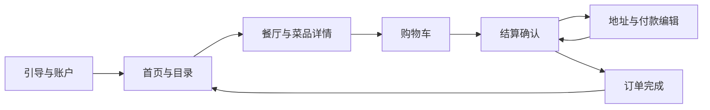

# 项目架构

## Pixso 来源

Pixso Desktop MCP 连接到「Food app design」。`xd page` 包含 33 个画板，其中 32 个为应用界面或输入状态，另有一个组件陈列板。`Components` 包含 18 个组件定义。引导和登录入口参考了 Flutter 转换输出。部分画板批量转换超时，使用 MCP 逐页截图和原始图层完成其余界面，并单独导出了菜品、引导、人物和成功插画素材。

源稿以 375 × 812 为基准，首页画板高度为 1307。Flutter 首页使用纵向滚动和固定底部导航，横向卡片保留独立滚动。源稿中超出画板边界的内容按所属区域重排，表单保持完整可操作。状态栏、导航区和键盘由 Android 绘制。原稿的 SF UI 字体在 Android 使用系统字体替代。

## 页面与数据流

| 模块 | 主要职责 |
| --- | --- |
| 应用入口 | `TastyFoodApp` 提供主题，并负责创建和释放 `OrderState`。 |
| 账户 | `AccountScreen` 按流程配置字段、校验和跳转。焦点由 Flutter 输入控件管理，Android 负责显示键盘。 |
| 发现 | 首页、目录和搜索读取 `catalog.dart` 的不可变样例。餐厅卡片和菜品卡片打开对应详情。 |
| 订单 | 购物车按菜品聚合数量，并由 `OrderState` 计算小计、运费和总价。结算页读取当前订单状态。 |
| 会话 | `OrderScope` 用 `InheritedNotifier` 把状态提供给需要刷新的页面。表单控制器和临时选项由各页面管理。 |
| 共用组件 | `ui.dart` 提供主题色、页面布局、页头、主按钮、面板和评分。餐厅和菜品卡片集中在 `food_cards.dart`。 |

源稿账号表单、配送信息和卡片字段在页面内校验。会话仅保留当前购物车、姓名、地址和付款展示所需的末四位及有效期。完整卡号和 CVV 只存在于卡片表单控制器中，密码只用于本地校验。演示订单提交后清空购物车。配送、认证和支付服务可以在各模块的提交入口接入。

## 验证环境

- Flutter 3.47.7、Dart 3.13.5。
- Android 11（API 30）、x64 模拟器，设备 ID 为 `127.0.0.1:5555`。
- Android 工程使用本机已有的 Gradle 8.14、AGP 8.11.1 和 Kotlin 2.2.20。当前 Flutter 可构建这组版本，并提示后续版本将提高最低要求。
- 截图时临时使用 375 × 812 逻辑尺寸，并保留 Android 原生键盘。截图结束后恢复模拟器原来的分辨率与密度。
- `flutter analyze` 没有发现问题，2 项组件测试通过。模拟器上完成了注册、找回密码、浏览和搜索、购物车、付款方式选择与订单提交。
